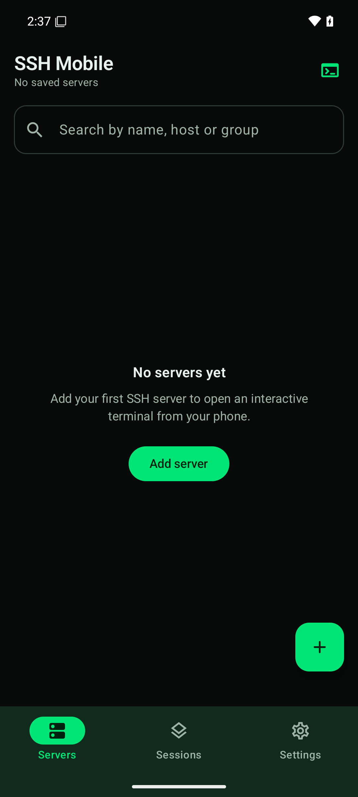
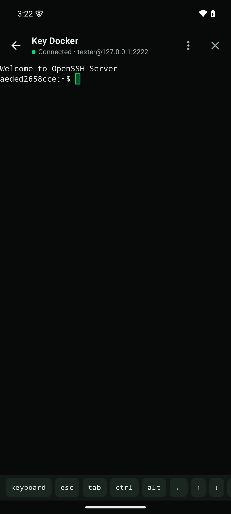
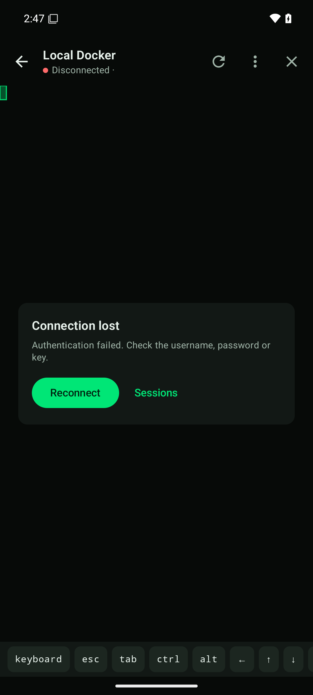
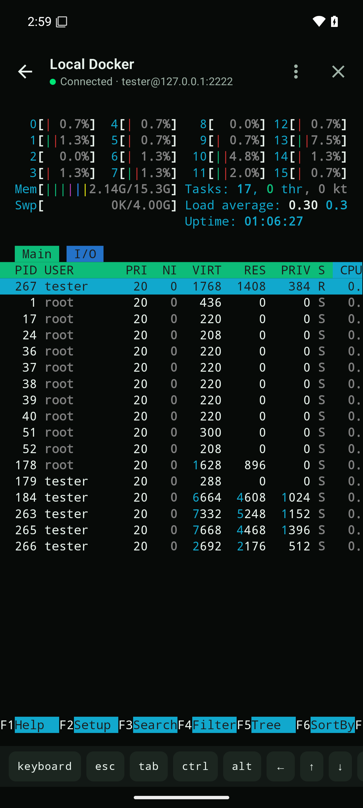
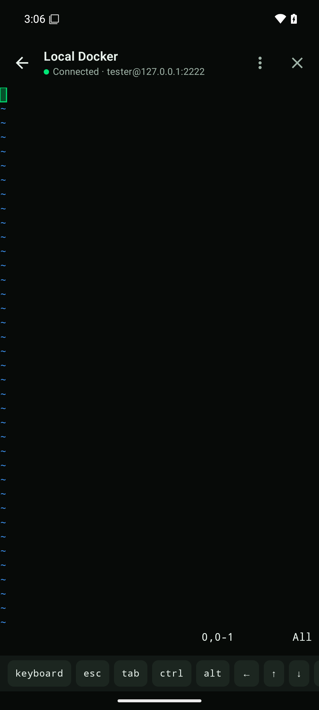
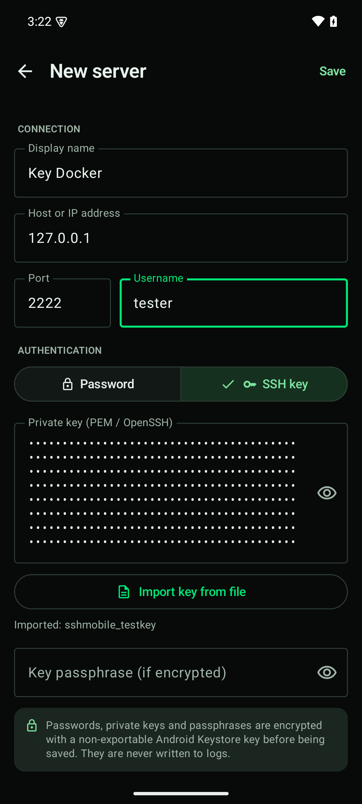
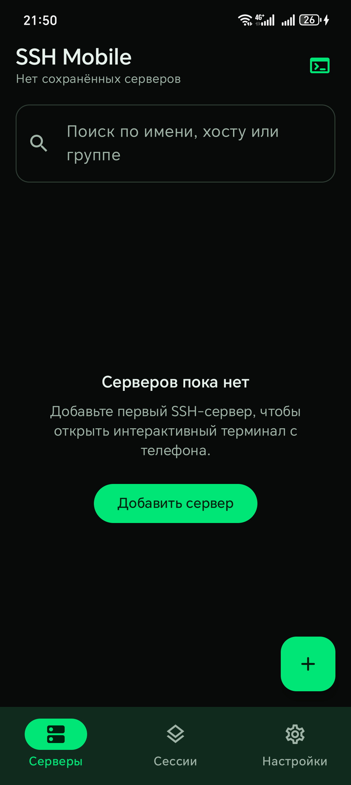
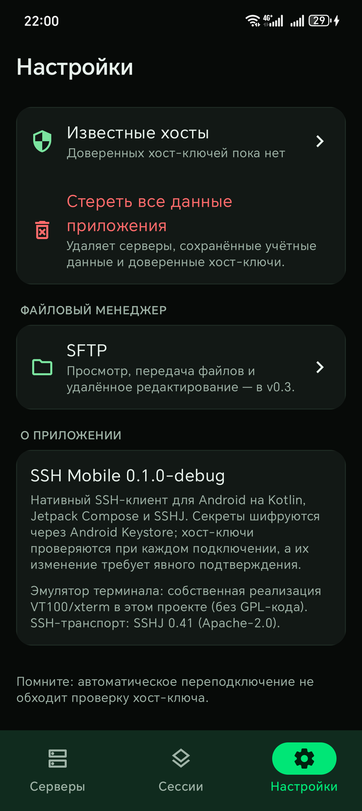

# SSH Mobile — SSH-клиент для Android (v0.3)

Нативный SSH-клиент для Android 10+ с интерактивным терминалом, менеджером серверов,
SFTP, jump host, port forwarding, проверкой host key и шифрованием секретов через
Android Keystore.

Стек: **Kotlin 2.1**, **Jetpack Compose + Material 3**, **MVVM + Repository**,
**SSHJ 0.41.2**, **Room 2.7.1**, **Android Keystore (AES-256-GCM)**, **Coroutines/StateFlow**,
**Gradle Kotlin DSL**.

| Dashboard | Терминал | Host key |
|---|---|---|
|  |  |  |

| htop | vim | SSH-ключ |
|---|---|---|
|  |  |  |

| Русский интерфейс | Настройки |
|---|---|
|  |  |

## Статус

- Исходный код **v0.2** (расширенный терминал) и **v0.3** (SFTP) готов; сборка **v0.3.0**
  отправлена на модерацию в RuStore, текущая активная версия — **v0.1.2**.
- Автоматические тесты (JVM + Robolectric) проходят, включая реальное SSH-рукопожатие
  и SFTP-сессии с in-process сервером Apache MINA SSHD, проверку русских/английских
  ресурсов и плюрализации.
- В v0.2 добавлены сниппеты и история команд, настройки шрифта и цветовых схем, ProxyJump,
  локальный/удалённый port forwarding, экспорт/импорт конфигурации без секретов.
- В v0.3 добавлен полноценный SFTP: просмотр каталогов, загрузка/скачивание с прогрессом,
  создание, переименование, удаление и смена прав.
- Проверено на эмуляторе **Android 15 (API 35)**: установка, вход по паролю, вход по
  SSH-ключу (импорт из файла), host-key confirmation с совпадающим fingerprint,
  интерактивный bash, htop, vim, resize PTY, две одновременные сессии.
- Release APK установлен на физическое устройство **HONOR LLY-LX1 (Android 14)**;
  проверены запуск, отсутствие падений, русский интерфейс и системная локализация.
- Поддерживаются русский и английский языки; язык выбирается в настройках или берётся
  из системы.

## Реализованные функции

### Менеджер серверов
- Добавление, редактирование и удаление серверов.
- Имя, host/IP, порт, пользователь.
- Пароль или приватный ключ (PEM/OpenSSH), passphrase для ключа.
- Группы, избранное, поиск по имени/host/группе.
- Локальное хранение в Room; быстрый запуск сессии одним нажатием.
- Импорт приватного ключа через системный файловый picker (SAF) с предварительной проверкой
  формата/пароля и показом типа ключа и fingerprint.
- Хранимые секреты не показываются обратно в UI; при редактировании поле можно оставить пустым.
- Форма не перекрывается экранной клавиатурой: контент прокручивается и учитывает IME insets.

### Локализация
- Русский и английский интерфейс, тёмная/светлая тема.
- Выбор языка в Settings: «Системный», English, Русский; применяется сразу, сохраняется
  между запусками.
- Все строки вынесены в ресурсы (`values` / `values-ru`), включая ошибки, диалоги host key
  и валидацию формы.

### SSH-терминал
- Полноценная интерактивная shell-сессия с PTY (`xterm-256color`).
- Собственный VT100/xterm-эмулятор (без GPL-кода): UTF-8, ANSI/SGR 16/256/truecolor,
  альтернативный экран, scrollback, вставка/удаление, scroll regions, DEC line drawing,
  bracketed paste, ответы на DA/DSR, title через OSC.
- Работает с bash, htop, vim, nano, less.
- Экранные клавиши: Esc, Tab, Ctrl (sticky), Alt (sticky), стрелки, Home/End, PgUp/PgDn,
  `^C`, `^D`, `^Z`, Paste, Copy.
- Аппаратная клавиатура: стрелки, F1–F12, Home/End, Del/Ins, Ctrl/Alt-комбинации.
- Копирование: выделение строки долгим нажатием + drag, кнопка Copy; просмотр и копирование
  всего буфера через меню.
- Вставка из системного clipboard, с bracketed paste, если приложение его включило.
- Resize терминала отправляется на сервер как window-change; проверено `stty size`.
- Несколько одновременных сессий, экран Sessions, закрытие одной/всех, reconnect.
- SSH jump host (ProxyJump) через сохранённый сервер-шлюз; проверяются оба host key.
- Локальный и удалённый port forwarding; по умолчанию проброс слушает `127.0.0.1`
  и закрывается вместе с сессией.

### SFTP
- Просмотр удалённых каталогов, переход вверх, обновление, создание папок.
- Загрузка и скачивание файлов через системный файловый picker (SAF) с прогрессом
  и очередью передач.
- Переименование, удаление (включая рекативное для каталогов) и смена прав
  восьмеричным режимом.
- Те же шифрованные учётные данные и строгая проверка host key, что и в терминале.
- Передачи идут по отдельному SFTP-каналу и не блокируют просмотр каталогов;
  активные передачи останавливаются при отключении.

### Безопасность
- Пароли, приватные ключи и passphrase шифруются AES-256-GCM ключом, который генерируется
  в Android Keystore (StrongBox при наличии) и не экспортируется.
- Строгая проверка host key: новый ключ требует подтверждения с SHA-256 fingerprint;
  изменение известного ключа показывается отдельным предупреждением (возможен MITM).
- Host key хранится per host/port/algorithm в Room.
- Пароли и ключи не пишутся в логи; SLF4J в SSHJ отключён (`slf4j-nop`).
- Backup приложения отключён (`allowBackup=false` + data extraction rules).
- Опциональный `FLAG_SECURE` (запрет скриншотов и скрытие в Recent).
- Очистка known hosts и полное удаление локальных данных в Settings.

### UX
- Тёмная тема по умолчанию, зелёный акцент, моноширинный терминал; светлая тема опционально.
- Размер и моноширинное семейство шрифта, 4 цветовые схемы терминала, scrollback,
  keep screen on, авто-reconnect, screenshots.
- Сниппеты команд и история терминала; запись истории выключена по умолчанию, данные шифруются Android Keystore.
- Управление known hosts, просмотр fingerprint.
- Экспорт и импорт конфигурации без секретов (пароли, ключи и passphrase не выгружаются).

## Быстрый старт

Требования:
- JDK 17 или 21;
- Android SDK Platform 35 и Build-Tools 35.0.0;
- Gradle-wrapper (Gradle 8.13 скачается автоматически) или локальный Gradle 8.13.

```bash
# local.properties
sdk.dir=/path/to/android-sdk

./gradlew assembleDebug
# APK: app/build/outputs/apk/debug/app-debug.apk

./gradlew testDebugUnitTest
```

Windows:

```powershell
.\gradlew.bat assembleDebug
.\gradlew.bat testDebugUnitTest
```

### Release-подпись

Создайте keystore **вне репозитория** и файл `keystore.properties` в корне проекта
(оба игнорируются Git):

```properties
storeFile=C:/secure/sshmobile-release.jks
storePassword=...
keyAlias=sshmobile
keyPassword=...
```

```bash
keytool -genkeypair -keystore C:/secure/sshmobile-release.jks -alias sshmobile \
  -keyalg RSA -keysize 4096 -validity 10000
./gradlew assembleRelease
```

Без `keystore.properties` release-сборка останется неподписанной; debug подписывается
стандартным debug-key. Секреты подписи в репозиторий не коммитятся.

### Готовые артефакты

| Артефакт | Путь | Размер |
|---|---|---|
| Debug APK | `dist/ssh-mobile-0.1.2-debug.apk` | 66.95 МБ (debug, без shrink) |
| Release APK (подписан) | `dist/ssh-mobile-0.1.2-release.apk` | 9.66 МБ |

SHA-256:

```
release: A0A0A0303683297B278D8901744AC17AFC2C7DF6469EBDF3478E4D7ED31AF851
debug:   D66B6C93768510CC2AFB668FD448F965C150ADC843279D64B4EA73391E42DCBE
```

Копии также лежат в `dist/`; контрольные суммы — `dist/SHA256SUMS.txt`.
Сертификат release-сборки и подробный отчёт: [docs/TESTING.md](docs/TESTING.md).

### RuStore

Материалы и пошаговая инструкция: [docs/RUSTORE.md](docs/RUSTORE.md), готовые тексты
карточки: [store/listing-ru.md](store/listing-ru.md), политика конфиденциальности:
[docs/PRIVACY.md](docs/PRIVACY.md), иконка и скриншоты — в `store/`.
APK подписан release-ключом (схема APK Signature v2); keystore и пароли в репозиторий
не входят. Перед загрузкой в консоль остаётся указать e-mail поддержки — единственное
поле карточки, которое нельзя заполнить из репозитория.

## Архитектура

```
app/src/main/java/dev/sshmobile/
  core/
    ssh/         SshEngine (интерфейс), SshjEngine, SshSftp, KnownHostsVerifier, HostKeys, PrivateKeyInspector
    terminal/    TerminalEmulator (VT100/xterm), TerminalInput, TextWidth, TerminalCommandTracker
    security/    SecretCipher, AndroidKeystoreSecretCipher, CryptoProviders
    database/    Room: AppDatabase, DAO, entities (миграции 1→2)
    session/     SshSessionManager, TerminalSession, SftpSessionManager, состояние сессий
    backup/      ConfigBackupCodec (JSON без секретов)
  data/
    repository/  ServerRepository, KnownHostRepository, SettingsRepository (DataStore),
                 TerminalCommandRepository, ConfigBackupRepository
  domain/model/  Server, ServerCredentials, ServerDraft, HostKeyChallenge
  ui/
    servers/     Dashboard, Add/Edit server
    terminal/    TerminalScreen, TerminalCanvas, ExtraKeysRow, PortForwardDialog,
                 TerminalCommandLibraryDialog, TerminalPalette
    sessions/    Sessions
    settings/    Settings, Known hosts
    sftp/        SftpScreen, SftpViewModel
    components/  общие composable, sessionErrorRes
    theme/
  navigation/    Compose Navigation  AppContainer.kt / SshMobileApplication.kt / MainActivity.kt
```

Сетевой слой скрыт за `SshEngine`; замена SSHJ на другую библиотеку не затрагивает UI,
эмулятор терминала и репозитории. Подробности: [docs/ARCHITECTURE.md](docs/ARCHITECTURE.md).

## Тестирование

```bash
./gradlew testDebugUnitTest
```

69 тестов, 0 падений:

- 22 теста терминального эмулятора (курсор, SGR, альтернативный экран, UTF-8, wide chars,
  scrollback, resize, DEC charset, OSC, DA/DSR, bracketed paste);
- 5 тестов распознавания введённых команд для истории;
- 9 интеграционных SSH-тестов: реальный handshake с Apache MINA SSHD, пароль и RSA-ключ,
  PTY 80×24, echo, resize, jump host с двумя host key, локальный port forwarding,
  отказ при неверном пароле, отказ при отклонённом host key, смена host key, fingerprint;
- 4 интеграционных SFTP-теста с `sshd-sftp`: листинг, создание/переименование/удаление,
  права доступа, upload/download с прогрессом;
- 9 тестов Room-репозитория серверов (шифрование at rest, обновление без смены секрета,
  избранное, удаление, повреждённый шифротекст, jump host);
- 3 теста known_hosts (per host/port/algorithm, timestamps, удаление);
- 4 теста сниппетов и истории команд (кодек и репозиторий);
- 6 тестов кодека экспорта и 5 тестов импорта/экспорта конфигурации без секретов;
- 2 теста локализации: английские/русские строки, плюрализация `one/few/many`.

Проверка на эмуляторе и ручной чек-лист: [docs/TESTING.md](docs/TESTING.md).

## Безопасность

Модель угроз, гарантии и ограничения: [docs/SECURITY.md](docs/SECURITY.md).

Коротко:
- Android Keystore + AES-GCM, ключ не покидает Keystore;
- строгий known-hosts с подтверждением fingerprint и предупреждением при смене ключа;
- секреты не логируются и не бэкапятся;
- MITM-защита не отключается никакими настройками;
- при компрометации разблокированного устройства/root-доступе защита секретов ограничена
  возможностями платформы.

## Известные ограничения

- SFTP: одновременно подключён один сервер; вложенные jump host не поддерживаются;
  редактирование файлов на месте не реализовано (файл скачивается и загружается обратно).
- Port forwarding: пробросы живут в процессе приложения и закрываются вместе с SSH-сессией;
  постоянных правил и автозапуска нет.
- Нет поддержки SSH agent, FIDO/U2F и сертификатов; поддерживаются пароль, PEM/OpenSSH-ключи
  (RSA/ECDSA/Ed25519) и passphrase.
- Мышь в терминале (mouse reporting) не поддерживается; TUI работают с клавиатурой.
- Выделение текста построчное, не посимвольное; полный буфер копируется через меню.
- Resize не делает reflow уже выведенного текста; содержимое обрезается/дополняется.
- Сессии живут в процессе приложения; foreground service для фона не используется, поэтому
  ОС может убить процесс и соединение. Явное закрытие и reconnect реализованы.
- Автопереподключение до 5 попыток с backoff; после исчерпания — ручной Reconnect.
- Диалог подтверждения host key автоматически отменяется через 180 секунд, если пользователь
  его не закрыл (защита от «висящего» подключения); при таймауте показывается отдельное
  сообщение.
- Нет паролей, запрашиваемых при каждом подключении: сохранённые креды используются для
  reconnect (это осознанный trade-off).
- Локализация: русский/английский/системный; остальные языки пока не добавлены.
- Ширина эмодзи/сложных grapheme-кластеров аппроксимируется; редкие шрифты могут смещать сетку.

## План развития

**Готово**

- **v0.1** — базовый SSH-клиент: серверы, вход по паролю/ключу, терминал, проверка host key. Опубликован в RuStore.
- **v0.2** — расширенный терминал: сниппеты и история команд, шрифты и цветовые схемы, ProxyJump, проброс портов, экспорт/импорт конфигурации без секретов.
- **v0.3** — SFTP: каталоги, загрузка/скачивание, права доступа, очередь передач. Сборка 0.3.0 отправлена на модерацию.

**v0.4 — фон и надёжность**
- [ ] foreground service для фоновых сессий: соединение не рвётся при уходе в фон;
- [ ] фоновые SFTP-передачи при закрытом приложении;
- [ ] блокировка приложения по биометрии/PIN и авто-блокировка по таймауту;
- [ ] экран известных хостов: просмотр и удаление сохранённых ключей;
- [ ] генерация и экспорт SSH-ключей (Ed25519/RSA) прямо в приложении;
- [ ] быстрый коннект из одной строки `user@host:port`;
- [ ] ярлыки серверов на домашнем экране.

**v0.5 — терминал и SSH**
- [ ] mouse reporting и посимвольное выделение, поиск по скроллбэку;
- [ ] сохранённые профили проброса портов на сервере;
- [ ] keyboard-interactive MFA (TOTP) и SSH-сертификаты;
- [ ] SOCKS5/HTTP-прокси;
- [ ] аппаратная клавиатура и настраиваемый ряд дополнительных клавиш;
- [ ] редактирование текстовых файлов на месте, мультивыделение и копирование/перемещение в SFTP.

**v0.6 — администрирование**
- [ ] мониторинг CPU/RAM/диска/uptime;
- [ ] Docker (контейнеры, статус, логи), Proxmox VM/LXC, OpenWrt, systemd;
- [ ] подтверждение опасных операций (удаление, reboot, stop service).

**v1.0 — десктоп (Windows/macOS/Linux)**
- [ ] вынести SSH/SFTP/терминальное ядро в общий JVM-модуль без зависимостей от Android (sshj уже работает на JVM);
- [ ] заменить Room на кроссплатформенное хранилище (SQLDelight/JDBC), настройки — в файл;
- [ ] секреты в системном хранилище ОС: Windows DPAPI/Credential Manager, macOS Keychain, Linux libsecret вместо Android Keystore;
- [ ] Compose Desktop UI: список серверов, вкладки терминала, панель SFTP, jump host и проброс портов;
- [ ] терминал под десктоп: аппаратная клавиатура, mouse reporting, посимвольное выделение, поиск по скроллбэку, ресайз окна;
- [ ] импорт конфигурации, экспортированной из Android-версии (тот же формат без секретов);
- [ ] дистрибутивы: MSI/MSIX (Windows), DMG (macOS), AppImage/deb (Linux), подпись сборок;
- [ ] автообновление через GitHub Releases.

**Инфраструктура**
- [ ] CI на GitHub Actions: сборка и тесты на каждый push;
- [ ] автоматическая сборка релиза и публикация в RuStore;
- [ ] инструментальные UI-тесты на устройстве/эмуляторе;
- [ ] Google Play и F-Droid как дополнительные площадки.

## Лицензии

- Исходный код проекта — [Apache License 2.0](LICENSE).
- SSHJ — Apache License 2.0.
- Bouncy Castle — Bouncy Castle License (MIT-подобная).
- AndroidX/Compose/Room — Apache License 2.0.
- Полный список: [THIRD_PARTY_LICENSES.md](THIRD_PARTY_LICENSES.md).
- Терминальный эмулятор и остальной код проекта — собственный, без GPL-зависимостей.
